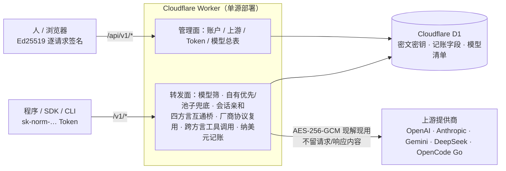

<div align="center">

# Norm

**无站的中转站。** 一份公开可复现的转发规则，而不是一台你租给我的机器。

https://norm.ntnl.io

</div>

## 这是什么

Norm 是一个 **Serverless 的 AI 中转站**：一个 Cloudflare Worker（Hono + 同源 SPA）加一个 D1。
仓库里不放任何上游提供商密钥，服务端不签发会话，不留存请求体与响应体。管理身份是浏览器本地持有的
Ed25519 密钥，消费凭据是独立的 `sk-norm-…` Token，每一条被隔离执行的请求都单独记账，每一个上游的
`base_url` 与构建哈希都公开可核验。

「中转站可信」在 Norm 里不是一句承诺，而是一个**可以自己跑一遍的构建**。



## 五条硬承诺

| 承诺 | 落地方式 |
|---|---|
| **Serverless，单一部署** | 一个 Cloudflare Worker（Hono）+ 一个 D1 + 同源静态资源。没有运维机器、没有后台进程 |
| **用户 BYOK** | 上游密钥仅在创建/更换时经请求体传一次，服务端以 Worker secret（`NORM_MASTER_KEY`）做 AES-256-GCM 封装入 D1（AAD 绑 `address\|providerId`），转发时现解现用，不落明文、不写日志 |
| **身份与消费分开** | 身份 = Ed25519 公钥（管资源，64 字节拓展形式 `seed‖publicKey`，与 Solana 密钥同形，私钥永不离开浏览器，无注册无密码无 cookie）；消费 = `sk-norm-…` Token（只记名字、不绑上游），一条 api key 就够 |
| **ZDR + 可信发布** | 不留请求体、响应体与明文密钥，只存记账所需的最小字段；构建产物 SHA-256 公开在 `/api/v1/attestation`，任何人可 `pnpm build && pnpm attest` 复算 |
| **上游来源公开可核验** | 后端只存事实：`base_url` 钉死在库里、转发时不可被请求头改写；按 `TRUSTED_BASE_URLS` 精确主机名清单标注 `trusted`，聚合视图公开在 `GET /api/v1/base-urls` |

## 用起来

打开 https://norm.ntnl.io，浏览器会为你生成一把 Ed25519 密钥——**地址就是你的账号**，第一次签名即开户，
自动获得 $1.00 演示授信。到「上游提供商」页选择协议并添加密钥（服务端用 Worker secret 封装），
打开「工具」里任一个页面发一次调用，底部会显示这一笔的请求 ID、扣费、余额、延迟、实际命中的上游主机与是否落入公共池。

### 两种身份，各管一段

| | 用来 | 凭据 | 入口前缀 |
|---|---|---|---|
| **身份** | 管理自己的资源：账户、上游提供商、下游 Token | Ed25519 逐请求签名（私钥在浏览器） | `/api/v1/*` |
| **Token** | 真正消费：调用模型、拉取模型清单 | `sk-norm-…`（库里只存 SHA-256） | `/v1/*` |

**两侧互不越界：推理接口只认 Token，管理接口只认签名。** `/v1/*` 上没有签名入口——签名能管资源，不能花钱；
每一笔消费必须落回一条具体的钥匙，账本才能回答「这段代码是谁在跑」。因此程序侧不需要懂签名，也不需要任何 Norm 专有头：
**一条 api key 就是完整调用**。

```bash
# 1) OpenAI SDK / Codex CLI / curl（Authorization: Bearer）
curl https://norm.ntnl.io/v1/chat/completions \
  -H "Authorization: Bearer sk-norm-…" \
  -H "Content-Type: application/json" \
  -d '{"model":"gpt-4o-mini","messages":[{"role":"user","content":"hi"}]}'

# 2) Anthropic SDK / Claude Code（x-api-key）
#    在 Claude Code 中设置：ANTHROPIC_BASE_URL=https://norm.ntnl.io  ANTHROPIC_API_KEY=sk-norm-…
curl https://norm.ntnl.io/v1/messages \
  -H "x-api-key: sk-norm-…" \
  -H "Content-Type: application/json" \
  -d '{"model":"claude-sonnet-4-20250514","max_tokens":64,"messages":[{"role":"user","content":"hi"}]}'

# 3) Google Gemini SDK（x-goog-api-key）
curl "https://norm.ntnl.io/v1/models/gemini-2.0-flash:generateContent" \
  -H "x-goog-api-key: sk-norm-…" \
  -H "Content-Type: application/json" \
  -d '{"contents":[{"role":"user","parts":[{"text":"hi"}]}]}'
```

换上游不用改程序、也不用换 Token：走哪条上游由服务端按规则自动挑。

## 方言互通与路由

### 两层分离：四方言互通 + 厂商协议零翻译复用

Norm 刻意**不做** $M \times N$ 的成对翻译矩阵，而是把「线缆方言」与「上游厂商契约」拆成两层：

1. **线缆方言层（`Dialect`，4 种）**：`openai-chat`、`openai-responses`、`anthropic-messages`、`google-gemini`。所有跨方言转换都经由规范中间态（Hub）中转，入口侧 4 段 + 出站侧 4 段（复杂度 $4 + 4$，不是 $4 \times N$）。
2. **上游协议层（`Protocol`，可扩展）**：只声明复用哪一种 `dialect` 并叠加厂商特有的传输/计价契约（固定 `base_url`、路径前缀、会话头、分时计价），**不包含任何翻译逻辑**——新增厂商协议时翻译代码增量为 **0**。

| 入口方言 | 常见客户端 | 上游方言 `openai-chat`<br/>（含 `opencode-go`、`naive`） | 上游方言 `openai-responses`<br/>（含 `deepseek`、`openai-oauth`） | 上游方言 `anthropic-messages` | 上游方言 `google-gemini` |
|---|---|---|---|---|---|
| `POST /v1/chat/completions` | OpenAI SDK / curl | **直通** | 桥接 | 桥接 | 桥接 |
| `POST /v1/responses` | Codex CLI | 桥接 | **直通** | 桥接 | 桥接 |
| `POST /v1/messages` | Anthropic SDK / Claude Code | 桥接 | 桥接 | **直通** | 桥接 |
| `POST /v1/models/{model}:generateContent` | Google SDK | 桥接 | 桥接 | 桥接 | **直通** |

- **同方言直通**：判定只看线缆方言（`entry.dialect === profile.dialect`）——例如 Responses 客户端打向 `deepseek`、Chat 客户端打向 `opencode-go` 均为直通；请求体按原始字节发出、响应体原样回来，不碰扩展字段（仅对 chat 流式补 `stream_options.include_usage` 以便记账，且客户端没要时自动吃掉多余用量帧）。
- **跨方言桥接**：经由规范中间态互译，**完整支持流式与跨方言 Tool Calling**（`tools` / `tool_choice` / `tool_calls` / 工具结果双向互译）。
- **厂商协议内置契约**：`deepseek` 复用 `openai-responses` 方言，钉死官方基址并按官方高峰/低谷时段两档计价；`naive` 复用 `openai-chat` 方言，钉死 NaiveAI 官方基址（`api.naive.ai`，它没有 Responses），并在发出去之前剥掉 `service_tier`——那个档位贵 10 倍且上游不回显，收下就无法核对；`opencode-go` 复用 `openai-chat` 方言，钉死推理面基址并自动派生 `x-opencode-session` 头以复用提示词缓存；`openai-oauth` 复用 `openai-responses` 方言，把一份 **ChatGPT 订阅**接成上游——凭据是一对 OAuth 令牌（`access_token` 过期前自动换新并写回库），基址填你自己的**一跳**（自建一跳：Worker 的 `fetch` 会在出站请求上盖 `cf-worker`，chatgpt.com 见到直接 403，一跳同时决定出口 IP 与绕开这条被盖戳的管线），请求头由 `src/oauth.ts` 给，且上游只认流式（非流式调用在 Norm 这一侧就被 `400 stream_required` 挡住，不去换一次注定失败的上游 400 与 Gas）；它也是唯一一条能**转写**的订阅上游：`/v1/audio/transcriptions` 在这里落到桌面客户端的 `/backend-api/transcribe`，只有转写，没有合成。
- **统一模型清单**：`GET /v1/models` 按方言将上游清单归一成 OpenAI 形状，**不扣 Gas、不写账本**。

### Qwen：一条协议上的文本、视觉与音频

`qwen` 协议把阿里云百炼接通成一条上游。文本与视觉走 OpenAI 兼容层——`image_url` 内容块按原始
字节透传，Norm 一个字段都不碰，所以多模态输入不需要 Norm 认识它；转写与合成走原生接口，
因为兼容层**没有** `/audio/transcriptions`（`qwen-audio-3.0-asr-flash` 只认原生多模态生成，
这也是 Qwen LB 存在的理由）。那层适配按 Qwen LB 的实现落地成 Norm 的一个协议：型号、调用方式
与价目都在代码里（`src/qwen.ts` / `src/pricing.ts`），跟着构建哈希一起被审查。

```bash
# 转写（multipart，file 必填，model / language 可选）
curl https://norm.ntnl.io/v1/audio/transcriptions \
  -H "Authorization: Bearer sk-norm-…" \
  -F 'file=@sample.wav' -F 'model=qwen-audio-3.0-asr-flash' -F 'language=zh'

# 合成（JSON，回 WAV 字节；账目挂在响应头上）
curl https://norm.ntnl.io/v1/audio/speech \
  -H "Authorization: Bearer sk-norm-…" \
  -H "Content-Type: application/json" \
  -d '{"input":"你好，世界","model":"qwen3-tts-flash","voice":"Cherry"}' --output speech.wav
```

一份 **ChatGPT 订阅**（`openai-oauth`）也能转写：订阅额度里没有 OpenAI 平台的
`/v1/audio/transcriptions`，只有桌面客户端的 `/backend-api/transcribe`——地址在 Codex 根旁边、
身份也要换成桌面那一个（OpenAI-LB 那条路，原样搬进 `chatgpt-desktop` 方言）。型号写
`gpt-4o-transcribe`：

```bash
curl https://norm.ntnl.io/v1/audio/transcriptions \
  -H "Authorization: Bearer sk-norm-…" \
  -F 'file=@sample.wav' -F 'model=gpt-4o-transcribe'
```

音频的两个入口只有一种线缆形状（OpenAI 的 `/v1/audio/*`），上游有三种：`openai-audio`
（把 Norm 指到一条**已经说 OpenAI 音频**的上游——Qwen LB、OpenAI、任何兼容实现，零翻译直通）、
`qwen-native`（Qwen 原生接口，`qwen` 协议自带）与 `chatgpt-desktop`（ChatGPT 订阅的桌面转写端点，
`openai-oauth` 协议自带，只有转写）。音频按秒（转写）、按字符或按 token（合成）
计价，**没有兜底价**：认不出的型号在打出去之前就拒——按秒与按字符不是同一个单位，猜错方向
会差几个数量级，而账单不能靠猜。

### 联网搜索：选一条搜索协议，不选模型

搜索是**独立端点** `POST /v1/web-search`，不是 `/v1/responses` 上的一件 `tools`：

```bash
curl https://norm.ntnl.io/v1/web-search \
  -H "Authorization: Bearer sk-norm-…" \
  -H "Content-Type: application/json" \
  -d '{"source":"deepseek","query":"rust 1.93 release notes","max_results":5}'
# → 200 {"created":1780000000,"source":"deepseek","sources":[{"url":"…","title":"…"}],…,"cost_usd_nanos":754000,"norm":{…}}
```

调用方选的只有 `source`——**一条搜索协议**，不是模型：

| `source` | 上游怎么把搜索做出来 | 计价 |
|---|---|---|
| `deepseek` | DeepSeek 的 Search API（`/v1/tools/search`）直连：搜索引擎本身，**没有任何模型** | 按**成功的调用**：一次 750,000 纳美元（每 1,000 次 0.75 美元） |
| `openai` | 上游把**宿主模型 + `web_search` 工具**包成同一条搜索信封（OpenAI LB 的 `/v1/web-search` 就是这样），宿主模型由那条上游部署时定下 | 按上游报的 **token**：Norm 看不到那条上游的宿主模型，所以按通用价目表折价 |

**为什么不包成 `/v1/responses` 带 `tools` 的调用。** 那条路要先有一个能调工具的宿主模型：模型读题、决定搜什么、再写一段散文把结果复述回来。代价是三重的——多一次推理（贵且慢）、多一份不确定性、同一次搜索按 token 再收一遍钱。搜索本身已经是一次确定的 API 调用，不需要谁来「决定」；真要那条路，`source: "openai"` 已经把「宿主模型 + `web_search`」封在上游那一侧了，调用方仍然只选协议。

- **入口**：`source`（`deepseek` / `openai`，必填）+ `query`（必填），其余参数是那条协议自己的语言：
  - `deepseek`：`max_results`（1–50，缺省 8）、`need_content`、`allowed_domains` / `blocked_domains`（裸域名、互斥，转发前折成 `site:` / `-site:`）；
  - `openai`：`search_context_size`、`filters.allowed_domains`、`user_location`，原样转给上游。
  
  给错协议给了别人的参数会 `400 param_unsupported` 并点名它属于谁——静默忽略是最坏的一种：调用方以为过滤生效了，拿到的是没过滤的一页。
- **选址**：方言挂在**协议**上（`ProtocolProfile.search`），不挂在模型上——`deepseek` 协议说 `deepseek-search`，`openai-search` 协议说 `openai-search`；只有说同一条方言的上游才进候选。规则仍是自有优先、公共池兜底、会话亲和。
- **信封**：`sources[]`，每条必有 `url`；两条协议说同一个形状，换 `source` 不必改代码。成功带 `cost_usd_nanos` 与四个回执头；失败、超时与「一条结果都没有」只收 Gas。

### 服务端选址规则

1. **按模型先筛**：依据 `provider_models` 排除已拉过清单但明确不含该模型的上游（未拉过清单的保留），筛空则直接返回 `404 model_not_served`；若上游仍回 400/404 称无该模型，则自动删掉错误快照、清亲和并换候选重试一次。
2. **自有优先，公共池兜底**：自己名下有可用上游时只用自己的；没有时自动落到站点公共池（响应 `norm.pool: true` 明示）。
3. **会话亲和**：带 `thread-id` 或 `session-id` 时在候选未变期间钉在同一条上游上（保护提示词缓存）；不带时按 rendezvous 稳定摊开。

## 安全模型与可信验证

Norm 选择把**防什么、不防什么**摆在台面上：

- **防什么**：拖库（D1 只有 AES-256-GCM 密文与 Token SHA-256）、会话劫持（无密码无 Cookie）、管理面重放（60 秒时间窗 + 请求自带幂等键）、暗中篡改转发目的地（`base_url` 钉死在库中，忽略任何覆盖头）、静默修改线上逻辑（构建哈希公开）。
- **不防什么**：中转转发在运行期必然看到明文密钥与明文内容，因此拿走 `NORM_MASTER_KEY` 且拿走 D1 即可解封密钥；Cloudflare Workers 托管运行时本身也不在自证范围内；`trusted` 是精确主机名清单而非官方身份的密码学证明。

**自己复算线上运行的代码字节：**

```bash
git clone https://github.com/No-Trade-No-Life/norm && cd norm
pnpm install && pnpm build && pnpm attest
# 将输出的 source_sha256 / assets_sha256 与 https://norm.ntnl.io/api/v1/attestation 逐字对照
```

## 计费与定价原则

- **纳美元整数记账**：单位一律是纳美元（1e-9 USD，不用浮点），避免极便宜调用被四舍五入为 0。
- **Gas 费与 Token 费分开结算（价值转移）**：
  - **动态 Gas 费（付给 Norm）**：单价表写在 `src/gas.ts`，从 **300 纳美元**（Worker 调用）起步，按实际经过的 Cloudflare 成本累加（异常日志摊销、基础/桥接/流式 CPU、D1 读上界与每一次真实 D1 行写）；自有上游稳态同日直通非流式为 **2,420 纳美元**（$0.00000242），流式 +60、跨方言桥接 +100、当日首次刷新密钥活跃日 +1,000、新会话写亲和 +1,000、跨用户 Token 转账入账 +1,000；
  - **Token 费（上游那边的 Token 价值，Norm 0 抽成）**：`input_tokens`（含缓存命中）/ `cached_tokens` / `output_tokens` 三项分开计价（价目表写在 `src/pricing.ts`，与 Gas 一起公开在 `GET /api/v1/pricing` 并进入 `source_sha256` 构建哈希）。**调用自己的上游时也按真价记 `token_nanos`，只是记成自转自**——同一账户的 `token_spend_nanos` 与 `earn_nanos` 同增，余额只减 Gas，账本因此答得出「这一次实际花了多少钱」，`norm.token_self_nanos` 就是其中自己转给自己的那部分；**调用公共池/他人上游时，实扣的 `token_billed_nanos` 直接转入该上游提供方的 `earn_nanos`**，上游提供方可在 `GET /api/v1/account/earnings` 与「用量与账本」页逐笔核对；
  -   - **供给 / 消费 / 净值**：同一把尺子量两端——**累计供给**（`earn_nanos`）是「我的上游被调用过多少 Token 价值」（他人调用 + 我自己用自有上游），**累计消费**（`token_spend_nanos`）是「我的下游调用掉多少 Token 价值」（他人/公共池上游 + 自有上游），**净值 = 供给 − 消费**（`net_supply_nanos`）就是我给其他用户提供的净价值；自己用自己的上游两边同增，净值不变。Gas 不进这条算式，它付给 Norm；
 `fee_nanos = gas_billed_nanos + token_billed_nanos = gas_fee_nanos + token_nanos − unbilled_nanos`，余额永不为负，全站价值严格守恒。
- **余额不足提前中止（零额外写库）**：入口设置安全余额阈值 **`MIN_BALANCE_NANOS = 10,000`**（$0.00001），低于该值直接返回 `402 insufficient_balance`，产生 **0 次 D1 写、0 次上游调用**；写亲和前、发往上游前与纠偏重试前同样在内存里做余额预算熔断。
- **纯读零写库，写全体补贴读全体**：只读操作（如 `GET /v1/models` 与管理面读接口）不计费且严格避免「读导致写」（不写 `last_used_at`、不回写 `affinities`）；免费读产生的基础设施成本在原则上由计费的写/推理操作全体按实际读写比通过 `GAS_SCHEDULE.read_subsidy` 交叉补贴（冷启动期暂置 `0`）。
- **失败收 Gas，不收 Token**：只要请求打到上游，Worker 与 D1 成本就已发生，上游 4xx/5xx 或超时照收 Gas（通过响应头 `X-Norm-Gas-Fee-Nanos` 标明），token 费为 0；未打到上游的校验失败（非 JSON、余额不足、无可用上游）不记账也不扣费。

> 原则上 Norm 只赚取合理的毛利率，会在技术手段上最小化用户的使用成本，但绝对不会做贴钱留用户的不可持续的事情。

1. **当前按 1.0× 成本价计费，只维持不亏本**：`GAS_MARGIN_BPS = 0`，单价表直接写在 `src/gas.ts` 里，未来调毛利率或改价 = 一次可被审查的代码提交。
2. **用工程降本直接反哺用户**：动态 Gas 按实际经过的付费点累加——少写一行 D1、调低日志采样率，用户账单自动变便宜（如已落地 #49 去重免写库、#50 砍掉 `requests` 4 条冗余索引，以及鉴权合并 JOIN + 延后 `last_used_at` 写库）。
3. **不贴钱留客**：每一条转发路径的边际成本都如实覆盖，不靠烧钱换量，也不因过线而倒挂。

完整的动态 Gas 操作码单价表、Cloudflare 列表价拆解、Workers Logs 建模与降本记录见 [`docs/economics.md`](docs/economics.md)。

## 自己部署一份

Norm 的价值来自「代码公开可复现、任何人都能另起一套」，两套部署之间没有任何信任依赖。

```bash
pnpm install
pnpm exec wrangler d1 create norm               # 1. 把返回的 database_id 填进 wrangler.jsonc
                                                # 2. 按需修改 wrangler.jsonc 中的 routes 与 POOL_ADMIN_ADDRESSES
openssl rand -base64 32 | tr '+/' '-_' | tr -d '=' \
  | pnpm exec wrangler secret put NORM_MASTER_KEY --config wrangler.jsonc
                                                # 3. 必填：32 字节 base64url 主密钥，缺失会 500
pnpm db:migrate                                 # 4. 应用远程 D1 迁移
pnpm deploy                                     # 5. 构建前端并上传 Worker（需要写入构建证明请用 pnpm release）
```

完整 CI 自动发布、最小权限 Cloudflare API Token 铸造、线上冒烟与清理步骤见 [`docs/deploy.md`](docs/deploy.md)。

## 本地开发

首次运行前，先准备本地 D1 迁移与主密钥（`.dev.vars` 已在 `.gitignore` 中）：

```bash
echo "NORM_MASTER_KEY=$(openssl rand -base64 32 | tr '+/' '-_' | tr -d '=')" > .dev.vars
pnpm db:migrate:local
```

常用命令：

```bash
pnpm dev              # wrangler dev（127.0.0.1:8787），本地 Worker + 本地 D1
pnpm preview          # Vite 前端开发服（127.0.0.1:5173），/api 与 /v1 代理到 8787
pnpm check            # typecheck + vitest 单元测试 + vite build
node scripts/e2e.mjs  # 起假上游（支持四种方言），用真身份打本地 Worker，300+ 项端到端断言
pnpm attest           # 计算 source_sha256 / assets_sha256，与 /api/v1/attestation 对照
```

## 文档索引

| 文档 | 内容 |
|---|---|
| [`docs/spec.md`](docs/spec.md) | 产品与架构完整规格（身份、BYOK、路由、计费、ZDR、取舍） |
| [`docs/api.md`](docs/api.md) | 全部公开、管理面（`/api/v1/*`）与转发面（`/v1/*`）接口契约 |
| [`docs/crypto.md`](docs/crypto.md) | 密码学契约（Ed25519 拓展密钥、签名与幂等键、AES-256-GCM 封装、Token 哈希） |
| [`docs/economics.md`](docs/economics.md) | Gas 费、Cloudflare 边际成本拆解、日志建模、降本记录与定价原则 |
| [`docs/deploy.md`](docs/deploy.md) | 自部署、GitHub Actions 可信发布、最小权限 Token 与线上冒烟 |
| [`docs/roadmap.md`](docs/roadmap.md) | 已完成能力与后续路线（链上结算、证据化来源核验、完整发布闭环） |
